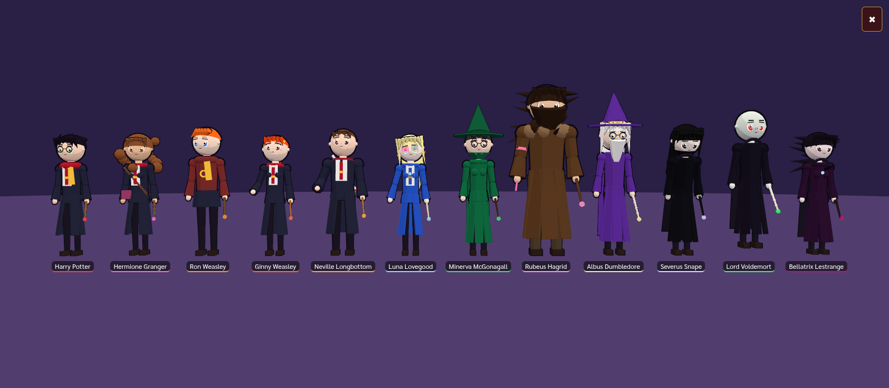

# The Last Battle of Hogwarts — Unofficial Fan Project

> **Disclaimer:** This is an unofficial, non-commercial fan project. It is not affiliated with, endorsed by, or connected to Warner Bros., Wizarding World, or J.K. Rowling. Harry Potter names and related marks belong to their respective owners. All visuals and audio in this game are original procedural primitives and synthesized sound; no assets from the films, books or official games are used.

▶ **Play:** https://kob3435-bot.github.io/hogwarts-last-battle/

3D browser cinematic action RPG + large-scale battle simulation (Three.js + TypeScript + Vite): 12-chapter story campaign (Thai/English), 41 anime-style characters, War Commander, Spectator, What If mode, free battle, explorable areas, replays, gamepad & touch.

An original-names build (no franchise names) is published separately: https://kob3435-bot.github.io/highspire-last-battle/

## Dev
    npm install
    npm run dev
    npm test
    npm run build            # fan build
    npm run build:fantasy    # original fantasy-named build
